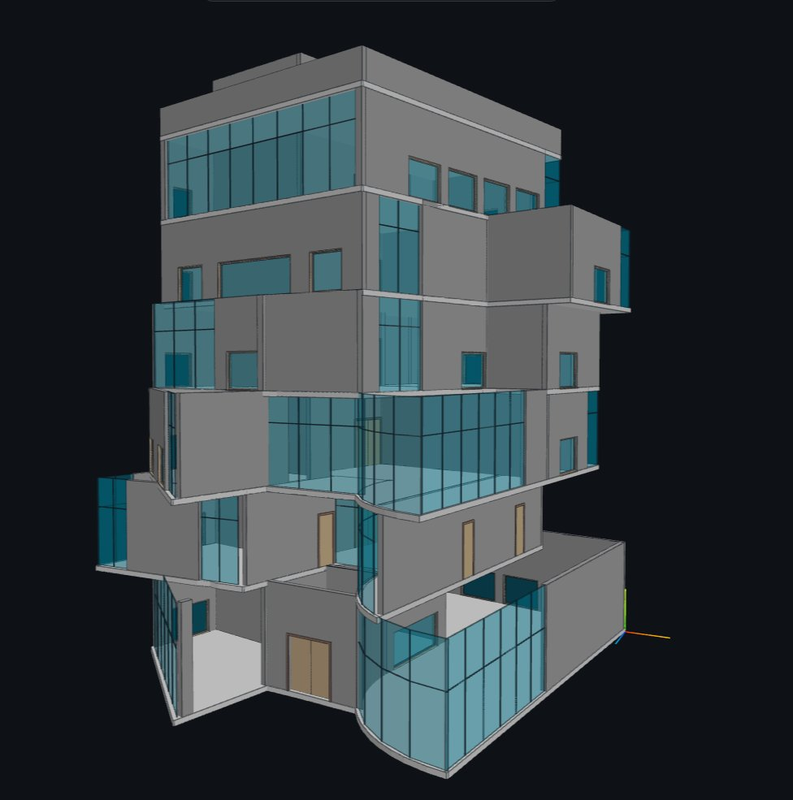
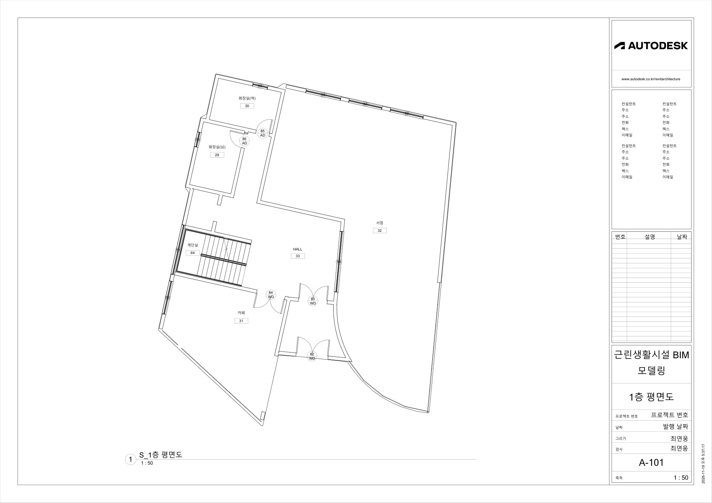
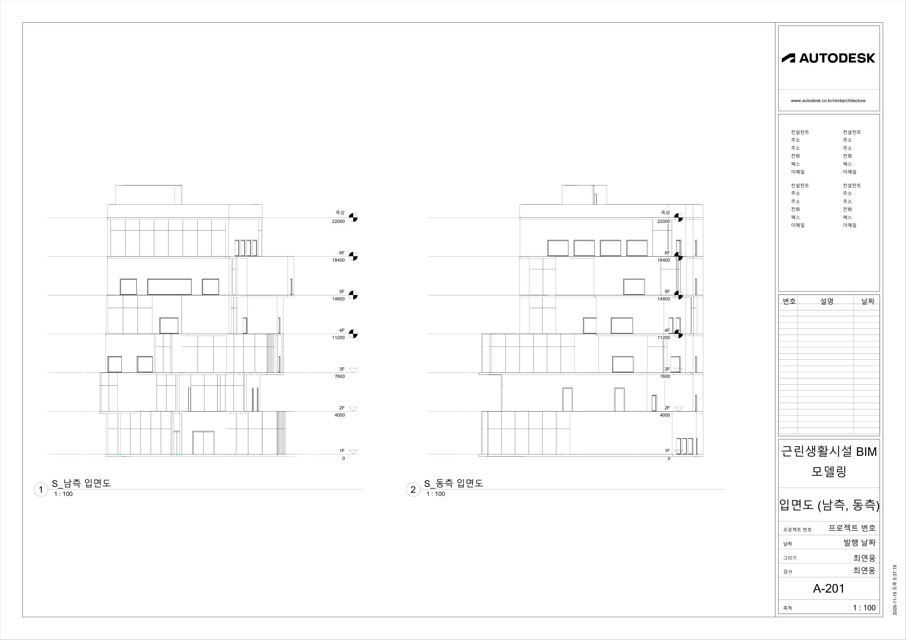
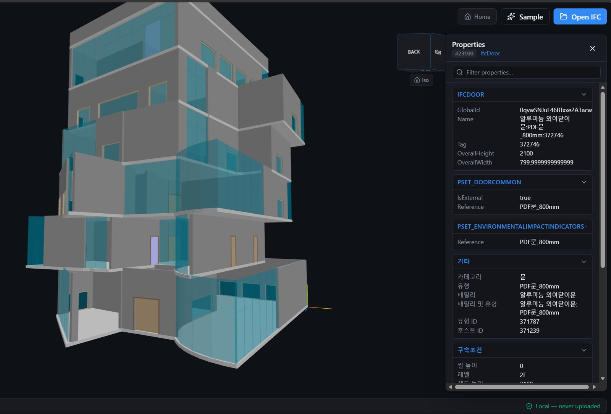

# PDF 평면도 → Revit BIM 자동 모델링

지상 6층 + 옥상 근린생활시설의 **벡터 PDF 평면도 7장**을 읽어 Revit 모델, 도면 시트, IFC까지 만든 프로젝트입니다.
Python(PyMuPDF)으로 PDF의 선 정보를 추출하고, Dynamo(PythonNet3) 스크립트로 Revit API를 호출해 요소를 자동 생성했습니다.
스크립트 작성과 검증에는 생성형 AI(Claude)와 Revit MCP 커넥터를 함께 활용했습니다.



## 결과 요약

| 항목 | 수량 |
|---|---|
| 벽 (200 / 300mm) | 198 |
| 커튼월 / 유리 패널 | 28 / 146 |
| 바닥 | 7 |
| 문 / 창 | 27 / 46 |
| 계단 / 난간 | 6 / 12 |
| 실(Room) | 28 (순면적 합계 약 844㎡) |
| 일람표 | 실 면적표, 문 일람표, 창 일람표, 벽 물량표 |
| 도면 시트 (A1) | 11장 — 평면 7, 입면 2, 단면 1, 표지 3D 1 |
| IFC4 | 모든 요소 + IfcSpace 28 + 기본 수량, 정보 손실 없음 확인 |

## 작업 흐름


### 1. PDF에서 형상 추출 (`extract/`, PC에서 실행)
PDF 선의 **두께**로 요소 종류를 나눴습니다.

| 선 두께 | 의미 |
|---|---|
| 1.438pt | 벽 이중선 |
| 0.24pt | 창·문·유리 (문 여닫이 호 포함) |
| 1.079pt | 계단 디딤판·승강기 |
| 0.12pt | 글자 외곽 (실 이름) |

- `walls2.py` 평행한 이중선 쌍(간격 3~10pt)을 벽 중심선과 두께로 변환하고, 벽 사이 빈틈을 문 호(arc) 유무로 문/창/개구부로 판별
- `floors2.py` 벽 띠를 합쳐 층별 바닥 외곽 폴리곤 생성
- `cw.py`, `cw2.py` 벽에 속하지 않는 가는 선을 커튼월 직선·곡선 경로로 정리

### 2. Revit 모델 생성 (`dynamo/`, Dynamo에서 순서대로 실행)
| 순서 | 스크립트 | 내용 |
|---|---|---|
| 01 | 모델생성_벽바닥창문 | 벽, 바닥(복합 구조), 창, 문 (여닫이 방향 포함) |
| 02 | 커튼월생성 | 직선·곡면 커튼월 |
| 03 | 계단_실생성 | 계단 + 계단참 + 난간, 실 배치 및 이름 |
| 04 | 실경계_일람표 | 실 구분선, 일람표 4종 |
| 05 | 도면시트_단면_3D | A1 시트 11장, 단면도 2, 3D 뷰 2, PDF·PNG 내보내기 |
| 06 | PDF_이미지_내보내기 | 시트는 유지하고 PDF·PNG만 다시 내보내기 |

**좌표 변환:** 각 층 평면뷰에 놓인 PDF 이미지의 중심과 축척(1:100, 1pt ≈ 35.3mm)을 읽어
`P(x, y) = (left + x·k, top − y·k, z)`로 변환합니다. 7장 모두 같은 원점에 맞춰 층간 위치를 정렬했습니다.

**재실행 안전성:** 스크립트가 만든 요소에는 주석(Comments) 태그(`PDF자동생성`, `PDF자동생성_커튼월`, `PDF자동생성_계단실`)를 달아,
다시 실행하면 해당 요소만 지우고 새로 만듭니다.

### 3. 도면

| 1층 평면도 (1:50) | 입면도 (1:100) |
|---|---|
|  |  |

### 4. IFC 내보내기와 검증
Revit **파일 → 내보내기 → IFC**에서 아래처럼 설정했습니다.

| 위치 | 설정 |
|---|---|
| 일반 | IFC4 Reference View, 공간 경계 = 첫 번째 레벨 |
| 추가 컨텐츠 | "뷰에서 보이는 요소만 내보내기" 해제 → 모델 전체 + 실 포함 |
| 특성 매핑 [...] | IFC 공통 특성 세트, Revit 특성 세트, 기본 수량, 재료 특성 세트 |

| 요소 | Revit | IFC |
|---|---|---|
| 벽 | 198 | IfcWall 198 |
| 커튼월 / 패널 | 28 / 146 | IfcCurtainWall 28 / IfcPlate 146 |
| 바닥 | 7 | IfcSlab 13 (계단참 6 포함) |
| 문 / 창 | 27 / 46 | IfcDoor 27 / IfcWindow 46 |
| 계단 / 난간 | 6 / 12 | IfcStair 6 / IfcRailing 12 |
| 층 | 7 | IfcBuildingStorey 7 |
| 실 | 28 | IfcSpace 28 |



## 실행 방법

1. Revit에서 층별 평면뷰(1F~옥상)에 PDF를 가져오기 → 축척 1:100, 같은 원점으로 정렬
2. (선택) PC에서 추출 다시 하기
   ```bash
   pip install pymupdf shapely
   mkdir out && PDF_DIR=pdf python extract/walls2.py && python extract/floors2.py
   ```
3. Dynamo에서 `dynamo/01` → `06` 순서로 `.dyn`을 열어 실행 (Python 엔진: PythonNet3)
4. 결과물은 바탕 화면 `BIM포트폴리오` 폴더에 저장

> 추출 결과(좌표 JSON)는 각 Dynamo 스크립트의 `DATA` 블록에 포함되어 있어, 2단계 없이 3단계만 실행해도 됩니다.

## 개발 환경
Revit 2027 · Dynamo (PythonNet3) · Python 3 (PyMuPDF, Shapely) · RevitClaudeConnector(MCP) · Claude

## 알려진 한계와 보완
- 폭 300mm 미만의 작은 창 개구부 17곳은 의도적으로 생략했습니다.
- 계단을 가로지르는 실 구분선은 Revit이 무시하므로, 계단 옆을 돌아가는 L자 선으로 실을 나눴습니다.
- `05` 스크립트의 시트 작성자 입력, 언더레이 끄기, 단면 표식 숨김은 실행 환경에서 적용되지 않아 **MCP 커넥터로 후보정**했습니다.
- 원본 평면도 PDF는 저장소에 포함하지 않았습니다.

## 폴더 구조
```
extract/   PDF → JSON 추출 (PyMuPDF)
dynamo/    Revit 생성·출력 스크립트 (.dyn + 같은 내용의 .py)
docs/images/  확인용 이미지, 도면, IFC 뷰어 캡처
```
